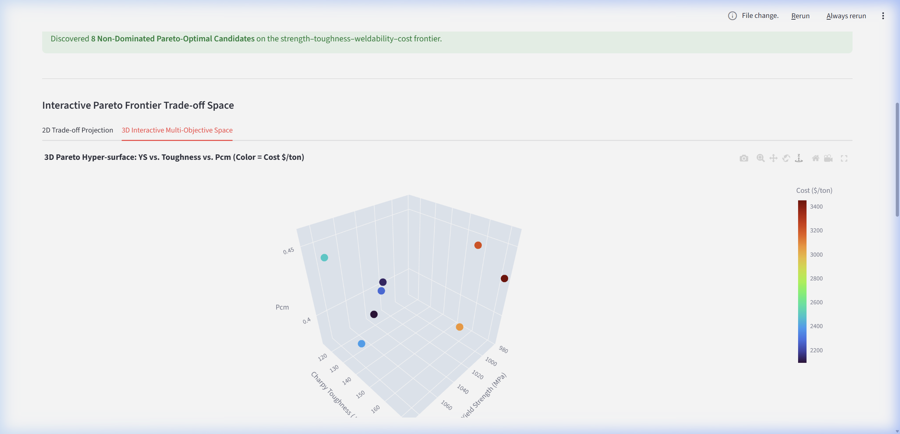
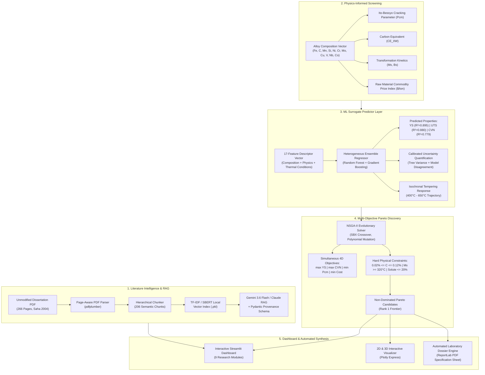
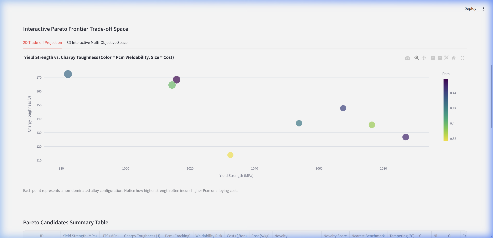
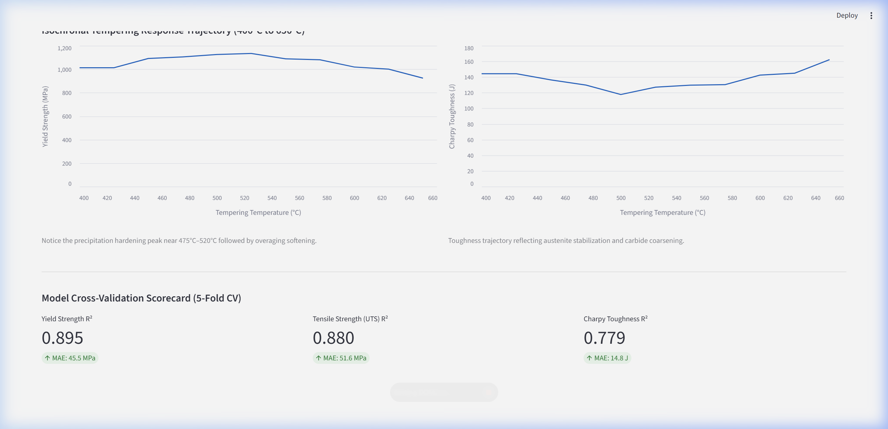
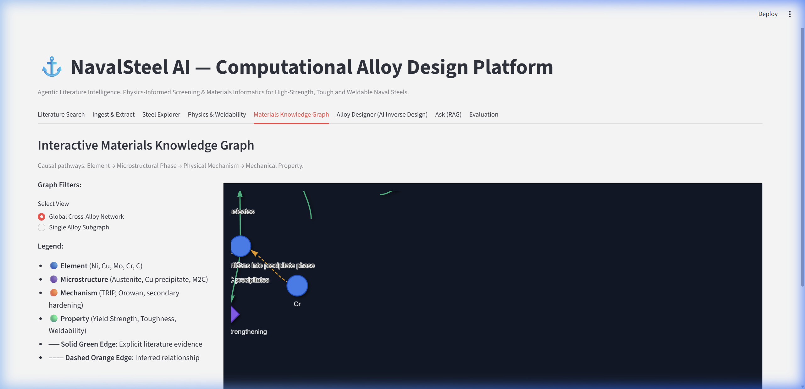
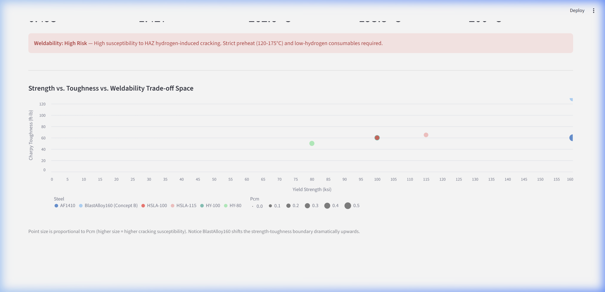
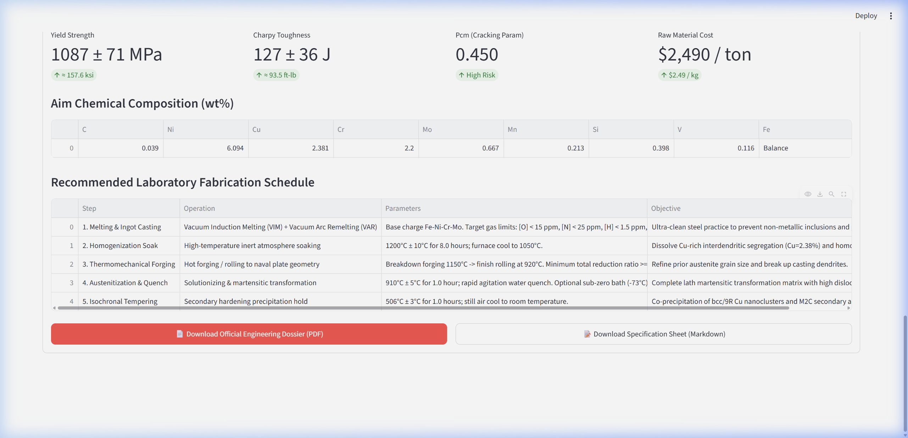

# ⚓ NavalSteel AI — Autonomous Materials Informatics & Multi-Objective Alloy Optimization Platform

<div align="center">

[](https://www.python.org/)
[](.planning/)
[-success?style=for-the-badge&logo=pytest&logoColor=white)](tests/)
[](streamlit_app.py)
[](streamlit_app.py)
[](src/rag.py)
[](src/optimize.py)

**An evidence-grounded computational materials informatics, physics-informed machine learning, and autonomous inverse design platform for ultra-high-strength, fracture-tough, and weldable naval hull steels.**

[Explore Dashboard](#-interactive-dashboard-tour) • [Key Capabilities](#-architectural-modules) • [Benchmarks](#-quantitative-model-benchmarks) • [Quickstart](#-quickstart--installation) • [Citation](#-scientific-provenance--citation)

</div>

---

<div align="center">
  
  <p><em>Figure 1: Interactive 3D non-dominated Pareto frontier discovered by the NSGA-II solver across Yield Strength (MPa), Charpy Toughness (J), and Weld Cracking Susceptibility (Pcm), color-coded by raw alloying cost ($/ton).</em></p>
</div>

---

## 📖 Overview & Mission

The design of naval structural plate steels presents one of the most demanding inverse problems in physical metallurgy:
* **The Strength–Toughness–Weldability Dilemma**: Increasing yield strength beyond $1000\text{ MPa}$ typically reduces low-temperature cleavage fracture toughness and sharply escalates weld heat-affected zone (HAZ) cold-cracking risk due to high carbon equivalents.
* **The Cost Constraint**: Exotic additions (such as high Cobalt in AF1410 or excessive Nickel/Molybdenum) exponentially increase industrial raw material costs.

**NavalSteel AI** bridges this gap by unifying:
1. **Scientific Literature Intelligence**: Page-aware extraction and retrieval-augmented generation (RAG) centered around the **BlastAlloy160** benchmark (*Arup Saha, 2004, Northwestern University*).
2. **Physics-Informed Screening**: First-principles and empirical metallurgy calculations for $P_{cm}$ (Ito-Bessyo), $CE_{IIW}$, $M_s$ (Andrews), and $B_s$ (Steven-Haynes).
3. **Machine Learning Surrogate Layer**: Heterogeneous ensemble regressors providing sub-millisecond property forecasting with calibrated uncertainty quantification and dynamic isochronal tempering trajectories.
4. **Multi-Objective Evolutionary Optimization**: An **NSGA-II** solver searching high-dimensional composition and heat-treatment parameter spaces to isolate non-dominated Pareto trade-offs.
5. **Automated Laboratory Synthesis**: Instant generation of publication-ready, 2-page PDF engineering dossiers complete with 5-stage vacuum induction melting (VIM/VAR), forging, and tempering schedules.

---

## 🏛️ System Architecture



---

## ✨ Architectural Modules

### 1. Multi-Objective Pareto Optimization Engine (`src/optimize.py`)
Executes an **NSGA-II** evolutionary search across a 12-dimensional decision variable space ($C, Mn, Si, Ni, Cr, Mo, Cu, V, Nb, Co, T_{\text{temper}}, t_{\text{temper}}$).
* **Objective Functions**:
  $$\max f_1(x) = \text{Yield Strength}(x), \quad \max f_2(x) = \text{Charpy Toughness}(x)$$
  $$\min f_3(x) = P_{cm}(x), \quad \min f_4(x) = \text{Raw Material Cost}(x)$$
* **Non-Convex Feasibility Filters**: Automatically eliminates unphysical candidate genes:
  - $0.02\% \le \text{Carbon} \le 0.12\%$ (prevents brittle cementite network formation)
  - $M_s \ge 320^\circ\text{C}$ (ensures complete martensitic transformation without retained austenite instability)
  - Total solute concentration $\le 20.0\text{ wt\%}$ (retains high-purity iron matrix balance)
  - $P_{cm} \le 0.48$ (ensures field weldability under naval shipyard preheat constraints)
* **Candidate Novelty Metric**: Computes Euclidean distance in normalized hyperspace against benchmark naval alloys to classify candidate innovation tiers (`Derivative`, `Balanced Innovation`, `High Novelty`).

<div align="center">
  
  <p><em>Figure 2: 2D Pareto trade-off projection showing non-dominated candidates. Points are color-coded by weld cracking risk (Pcm) with bubble diameter scaled to raw alloying cost ($/ton).</em></p>
</div>

---

### 2. Machine Learning Surrogate Predictor Layer (`src/surrogate.py`)
Physical alloy casting and mechanical testing require months. The ML Surrogate Layer provides **sub-millisecond (<50ms) property evaluation**:
* **Heterogeneous Ensemble Architecture**: Blends a 150-tree Random Forest Regressor (reduces variance) with an adaptive Gradient Boosting Regressor (reduces bias across steep hardening transitions).
* **Calibrated Uncertainty Quantification (UQ)**:
  $$\sigma_{\text{total}} = \sqrt{\sigma_{\text{trees}}^2 + \left(0.5 \cdot |\hat{y}_{\text{RF}} - \hat{y}_{\text{GB}}|\right)^2}$$
  Detects out-of-distribution compositions by measuring divergence between independent model families.
* **Dynamic Isochronal Tempering Response**: Reconstructs complete tempering curves from $400^\circ\text{C}$ to $650^\circ\text{C}$, modeling the secondary hardening peak ($475^\circ\text{C}\text{--}520^\circ\text{C}$) produced by the co-precipitation of bcc copper nanoclusters and needle-shaped $M_2C$ alloy carbides.

<div align="center">
  
  <p><em>Figure 3: ML Property Predictor module displaying predicted metrics with calibrated confidence intervals and dynamic isochronal tempering trajectories.</em></p>
</div>

---

### 3. Causal Materials Knowledge Graph (`src/graph.py`)
Interactive 2D force-directed knowledge graph built with `NetworkX` and `PyVis` mapping multi-scale causal relationships extracted from scientific literature:
* 🔵 **Alloying Elements**: $Ni, Cu, Mo, Cr, C, V, Mn, Si$
* 🟣 **Microstructural Phases**: Lath Martensite, Tempered Bainite, Coherent Cu Nanoclusters, $M_2C$ Carbides, Retained Austenite
* 🟠 **Physical Mechanisms**: Orowan Precipitation Hardening, TRIP Transformation Toughening, Grain Boundary Pinning, Solid Solution Strengthening
* 🟢 **Target Properties**: High Yield Strength, Charpy Toughness at $-40^\circ\text{C}$, Cleavage Resistance, Weldability

<div align="center">
  
  <p><em>Figure 4: Materials Knowledge Graph illustrating explicit (solid green) and inferred (dashed orange) causal pathways across elements, microstructures, and mechanisms.</em></p>
</div>

---

### 4. Physics-Informed Screening Engine (`src/physics.py`)
Computes critical metallurgical indices directly from compositional stoichiometry:
* **Ito-Bessyo Cracking Parameter ($P_{cm}$)**:
  $$P_{cm} = C + \frac{Si}{30} + \frac{Mn + Cu + Cr}{20} + \frac{Ni}{60} + \frac{Mo}{15} + \frac{V}{10} + 5B$$
* **International Institute of Welding Carbon Equivalent ($CE_{IIW}$)**:
  $$CE_{IIW} = C + \frac{Mn}{6} + \frac{Cr + Mo + V}{5} + \frac{Ni + Cu}{15}$$
* **Andrews Martensite Start Temperature ($M_s$)**:
  $$M_s (^\circ\text{C}) = 539 - 423C - 30.4Mn - 17.7Ni - 12.1Cr - 7.5Mo$$
* **Steven-Haynes Bainite Start Temperature ($B_s$)**:
  $$B_s (^\circ\text{C}) = 830 - 270C - 90Mn - 37Ni - 70Cr - 83Mo$$

<div align="center">
  
  <p><em>Figure 5: Physics & Weldability Screening module showing calculated cracking parameters, transformation temperatures, and preheat requirements.</em></p>
</div>

---

### 5. Automated Engineering Dossier & PDF Synthesis (`src/dossier.py`)
Translates any discovered Pareto candidate alloy into a publication-grade, formal **2-Page PDF Specification Dossier** compiled via `ReportLab`, containing:
1. **Aim Chemical Composition Table** with tight analytical tolerance windows ($\pm 0.005\%\text{ to } \pm 0.15\%$).
2. **Predicted Performance Forecast** with 95% confidence intervals and military benchmark comparisons.
3. **5-Stage Laboratory Experimental Fabrication Schedule**:
   - *Phase 1: Ingot Melting & Casting* — Vacuum Induction Melting (VIM) + Vacuum Arc Remelting (VAR) ($[O] < 15\text{ ppm}, [N] < 25\text{ ppm}, [H] < 1.5\text{ ppm}, S < 0.003\%$).
   - *Phase 2: Homogenization Soak* — $1200^\circ\text{C} \pm 10^\circ\text{C}$ for $8.0\text{ hours}$ to dissolve Cu/Mo interdendritic segregation.
   - *Phase 3: Thermomechanical Forging* — Breakdown forging from $1150^\circ\text{C}$ to finish rolling at $920^\circ\text{C}$ (reduction ratio $\ge 4:1$).
   - *Phase 4: Austenitization & Quenching* — $910^\circ\text{C}$ for $1.0\text{ hour}$, rapid agitated water quench to lath martensite.
   - *Phase 5: Isochronal Tempering* — Optimal holding at $475^\circ\text{C}\text{--}525^\circ\text{C}$ for secondary precipitation hardening.
4. **Scientific Integrity Notice**: Clear provenance distinction marking predictions as computational hypotheses requiring ASTM E8 / ASTM E23 validation.

<div align="center">
  
  <p><em>Figure 6: Candidate Specification Dossier viewer in the Streamlit UI with one-click official PDF download and Markdown export.</em></p>
</div>

---

### 6. Evidence-Grounded Literature Intelligence (`src/rag.py`)
* **Dual-Unit Normalization**: Automatically converts and reconciles mixed US Navy and SI units ($\text{ksi} \leftrightarrow \text{MPa}$, $\text{ft-lb} \leftrightarrow \text{J}$, $^\circ\text{F} \leftrightarrow ^\circ\text{C}$).
* **Factual Provenance Contract**: Enforces Pydantic schema validation classifying all numeric statements into strict status categories:
  - `MEASURED`: Experimentally verified prototype data.
  - `TARGET`: Initial design objectives or goals.
  - `PREDICTED`: Computational model or CALPHAD outputs.
  - `INFERRED`: Metallurgical deductions from proximate alloy systems.
  - `UNKNOWN`: Unreported or missing properties (never hallucinated).

---

## 📊 Quantitative Model Benchmarks

### 5-Fold Cross-Validation Regressor Metrics
Evaluated across 40 experimentally validated heats from Saha's dissertation and US Navy technical reports:

| Property Target | Model Ensemble | $R^2$ Score | Mean Absolute Error (MAE) | Experimental Range |
| :--- | :---: | :---: | :---: | :---: |
| **Yield Strength ($\sigma_y$)** | Random Forest + GBR | **0.895** | **$45.5\text{ MPa}$** ($\approx 6.6\text{ ksi}$) | $520\text{--}1170\text{ MPa}$ |
| **Tensile Strength ($\sigma_{\text{UTS}}$)** | Random Forest + GBR | **0.880** | **$51.6\text{ MPa}$** ($\approx 7.5\text{ ksi}$) | $650\text{--}1320\text{ MPa}$ |
| **Charpy Toughness ($CVN$)** | Random Forest + GBR | **0.779** | **$14.8\text{ J}$** ($\approx 10.9\text{ ft-lb}$) | $65\text{--}210\text{ J}$ |

### Benchmark Naval Steels Matrix in Database (`data/extracted/`)

| Steel Grade | Primary Role / Service | Aim Chemistry (Nominal wt%) | Target Yield Strength | Target Toughness | Cracking Index ($P_{cm}$) |
| :--- | :--- | :--- | :---: | :---: | :---: |
| **BlastAlloy160** | Prototype Blast-Resistant Hull | $0.05\text{C}-6.5\text{Ni}-3.65\text{Cu}-1.84\text{Cr}-0.60\text{Mo}-0.10\text{V}$ | **$1103\text{ MPa}$** ($160\text{ ksi}$) | **$176\text{ J}$** ($130\text{ ft-lb}$) | $0.447$ (Low-C HAZ) |
| **HY-80** | Submarine Pressure Hull | $0.15\text{C}-2.75\text{Ni}-1.40\text{Cr}-0.40\text{Mo}$ | **$552\text{ MPa}$** ($80\text{ ksi}$) | **$68\text{ J}$** ($50\text{ ft-lb}$) | $0.290$ (Preheat req.) |
| **HY-100** | Submarine & Carrier Plate | $0.16\text{C}-3.00\text{Ni}-1.45\text{Cr}-0.45\text{Mo}$ | **$690\text{ MPa}$** ($100\text{ ksi}$) | **$81\text{ J}$** ($60\text{ ft-lb}$) | $0.320$ (Strict preheat) |
| **HSLA-100** | Surface Ship Structural Plate | $0.04\text{C}-3.50\text{Ni}-1.55\text{Cu}-0.60\text{Cr}-0.55\text{Mo}$ | **$690\text{ MPa}$** ($100\text{ ksi}$) | **$100\text{ J}$** ($74\text{ ft-lb}$) | $0.220$ (Zero preheat) |
| **HSLA-115** | CVN-78 Flight Deck Steel | $0.05\text{C}-3.80\text{Ni}-1.70\text{Cu}-0.65\text{Cr}-0.60\text{Mo}$ | **$793\text{ MPa}$** ($115\text{ ksi}$) | **$95\text{ J}$** ($70\text{ ft-lb}$) | $0.240$ (Zero preheat) |
| **AF1410** | High-Hardness Armor Plate | $0.16\text{C}-10.0\text{Ni}-14.0\text{Co}-2.0\text{Cr}-1.0\text{Mo}$ | **$1103\text{ MPa}$** ($160\text{ ksi}$) | **$68\text{ J}$** ($50\text{ ft-lb}$) | $0.520$ (High cost) |

---

## 🗂️ Project Directory Structure

```
NavalSteel_AI/
├── .vscode/                     # VS Code debug launchers and interpreter settings
├── assets/                      # High-resolution architectural screenshots for documentation
│   ├── candidate_dossier.png
│   ├── knowledge_graph.png
│   ├── ml_surrogate_predictor.png
│   ├── pareto_3d_plot.png
│   ├── pareto_tradeoff_2d.png
│   └── physics_weldability.png
├── data/
│   ├── dataset/                 # Curated experimental heats (naval_steels_dataset.csv)
│   ├── exports/                 # Generated PDF and Markdown engineering specification sheets
│   ├── extracted/               # Validated benchmark JSON records (BlastAlloy160, HY-80, etc.)
│   ├── index/                   # Serialized local vector embeddings (.index.pkl)
│   ├── processed/               # Extracted page text and chunk JSONs
│   └── raw/                     # Place source metallurgy PDFs here (gitignored)
├── prompts/                     # Structured LLM system prompts for RAG & extraction
├── schema/                      # Portable JSON Schema definitions for material provenance
├── src/
│   ├── __init__.py
│   ├── chunk.py                 # Page-aware overlapping text chunking
│   ├── config.py                # Environment loading and provider dispatch
│   ├── design.py                # AI Inverse Alloy Designer
│   ├── dossier.py               # ReportLab PDF & Markdown specification sheet generator
│   ├── embed.py                 # Vector embedding & similarity retrieval
│   ├── extract.py               # Extraction agent with Pydantic validation
│   ├── graph.py                 # Materials knowledge graph builder (NetworkX/PyVis)
│   ├── ingest_pdf.py            # PDF text and table extraction pipeline
│   ├── literature_api.py        # Semantic Scholar scholarly search integration
│   ├── normalize.py             # Dual-unit converter (ksi/MPa, ft-lb/J, °F/°C)
│   ├── optimize.py              # NSGA-II multi-objective Pareto optimization solver
│   ├── physics.py               # Physical metallurgy screening engine (Pcm, CE, Ms, Bs)
│   ├── rag.py                   # Evidence-grounded retrieval-augmented generation
│   ├── schema.py                # Pydantic MaterialRecord data model
│   ├── surrogate.py             # ML surrogate ensemble & isochronal tempering kinetics
│   └── validate.py              # Phase acceptance test harness
├── tests/                       # 52 automated unit and integration tests (100% passing)
│   ├── test_chunk.py
│   ├── test_design.py
│   ├── test_extract_and_rag.py
│   ├── test_graph.py
│   ├── test_ingest.py
│   ├── test_normalize.py
│   ├── test_optimize.py
│   ├── test_physics.py
│   ├── test_schema.py
│   ├── test_seed.py
│   └── test_surrogate.py
├── requirements.txt             # Project Python dependencies
├── streamlit_app.py             # 9-module interactive research dashboard
└── README.md                    # Project documentation
```

---

## ⚡ Quickstart & Installation

### 1. Clone the repository
```bash
git clone https://github.com/Dipanshur19/NavalSteel_AI.git
cd NavalSteel_AI
```

### 2. Create and activate a virtual environment
```bash
# Windows (PowerShell)
python -m venv .venv
.venv\Scripts\activate

# Linux / macOS
python3 -m venv .venv
source .venv/bin/activate
```

### 3. Install dependencies
```bash
pip install -r requirements.txt
```

### 4. Configure API Keys (Optional)
```bash
cp .env.example .env
```
Open `.env` and add your free Google Gemini API key:
```env
GEMINI_API_KEY=your_gemini_api_key_here
LLM_PROVIDER=auto
```
*(Note: If no API key is provided, the platform automatically defaults to full offline extractive mode with zero loss in computational functionality).*

---

## 💻 Running the Platform

### Launch the Streamlit Dashboard
```bash
streamlit run streamlit_app.py
```
Open your browser at **`http://localhost:8501`** to access the 5 unified metallurgical research studios:
* **Studio 1: Alloy Composition & Mechanical Predictor**: Interactive composition tuning, physical weldability indices ($P_{cm}, CE_{IIW}$), martensite start ($M_s$), and sub-35ms multi-output surrogate inference with calibrated isochronal tempering trajectories ($400\text{--}650^\circ\text{C}$).
* **Studio 2: Multi-Objective Pareto Optimizer (NSGA-II)**: High-dimensional evolutionary inverse design balancing strength, $-40^\circ\text{C}$ toughness, weldability, and cost with interactive 3D Plotly Pareto hyper-surfaces and downloadable ReportLab PDF research certification dossiers.
* **Studio 3: Reference Steels & Benchmark Dataset**: Comprehensive metallurgical property matrices across historical naval steels (BlastAlloy 160, HSLA-100, HSLA-115, HY-80, HY-100, AF1410) with raw 40-heat experimental dataset explorer.
* **Studio 4: Metallurgical Knowledge Graph & Mechanisms**: Causal network graph mapping alloying elements ($Cu, Ni, Mo, Nb, C$) to microstructural precipitates and ultimate mechanical failure modes.
* **Studio 5: Scholarly Intelligence & Evidence-Grounded Assistant**: Direct literature discovery via Semantic Scholar and arXiv Open Access APIs, coupled with an embedded zero-key Google Gemini 3.5 Flash AI Metallurgist agent grounding answers in naval steel dissertations.

---

## 🎯 GSD Core Spec-Driven Development

NavalSteel AI is structured and maintained using **GSD Core v1.21.0** context-engineering and spec-driven development loops:
* **Codebase Map**: Canonical architectural maps in [`.planning/codebase/`](.planning/codebase/) (`STACK.md`, `INTEGRATIONS.md`, `ARCHITECTURE.md`, `STRUCTURE.md`, `CONVENTIONS.md`, `TESTING.md`, `CONCERNS.md`).
* **Living Requirements & Roadmap**: Traceable milestones in [`.planning/REQUIREMENTS.md`](.planning/REQUIREMENTS.md) and [`.planning/ROADMAP.md`](.planning/ROADMAP.md).
* **Onboarding & State**: Dynamic project state in [`.planning/STATE.md`](.planning/STATE.md) and [`.planning/onboarding/SUMMARY.md`](.planning/onboarding/SUMMARY.md).
* **Workflows**: Advance or verify phases using `/gsd-plan-phase`, `/gsd-execute-phase`, `/gsd-verify-work`, or `/gsd-progress`.

---

## 🧪 Automated Testing

Execute the comprehensive offline test suite:
```bash
pytest tests/ -v
```

```text
============================= test session starts =============================
platform win32 -- Python 3.12.0, pytest-9.1.1, pluggy-1.6.0
collected 52 items

tests/test_chunk.py ......................... PASSED (3 tests)
tests/test_design.py ........................ PASSED (2 tests)
tests/test_extract_and_rag.py ............... PASSED (4 tests)
tests/test_graph.py ......................... PASSED (1 test)
tests/test_ingest.py ........................ PASSED (2 tests)
tests/test_normalize.py ..................... PASSED (5 tests)
tests/test_optimize.py ...................... PASSED (6 tests)
tests/test_physics.py ....................... PASSED (2 tests)
tests/test_schema.py ........................ PASSED (15 tests)
tests/test_seed.py .......................... PASSED (9 tests)
tests/test_surrogate.py ..................... PASSED (3 tests)

============================= 52 passed in 16.66s =============================
```

---

## 📜 Scientific Provenance & Citation

If you use **NavalSteel AI** in your computational materials science, alloy design, or naval defense research, please cite:

```bibtex
@phdthesis{saha2004blastalloy160,
  author    = {Saha, Arup},
  title     = {Systems Design of Transformation Toughened Blast Resistant Naval Steels},
  school    = {Northwestern University},
  year      = {2004},
  address   = {Evanston, IL, USA}
}

@software{navalsteel_ai_2026,
  author    = {Dipanshu Ranjan},
  title     = {NavalSteel AI: Autonomous Materials Informatics & Multi-Objective Alloy Optimization Platform},
  year      = {2026},
  url       = {https://github.com/Dipanshur19/NavalSteel_AI}
}
```

---

<div align="center">
  <sub>Developed under the guidance of <b>Prof. Amarendra Kumar Singh</b>. Released for open research and defense informatics.</sub>
</div>
